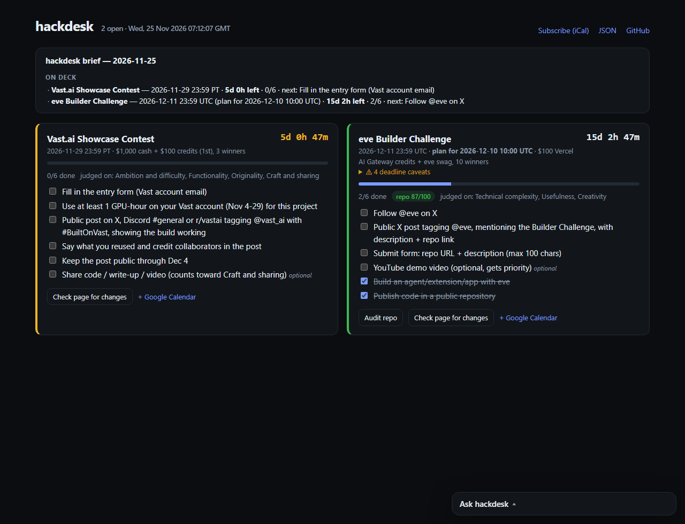
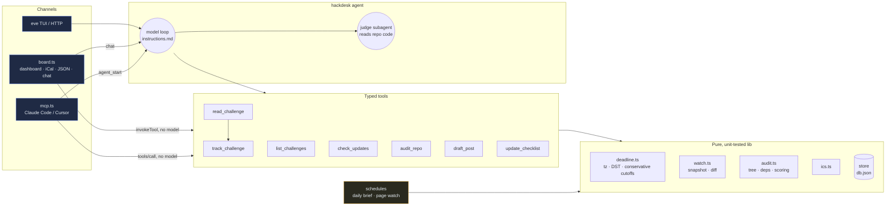

# hackdesk

**A submission desk for people who enter too many hackathons. Built with [eve](https://eve.dev).**

Entries rarely lose because the code is bad. They lose to the fine print: a deadline in a timezone you didn't notice, "submit *before* Dec 11", a repo that is still private, a post that is missing the required hashtag, a rule the organizers added in week two. hackdesk reads the rules so you don't miss any of them.



You give it a challenge URL. hackdesk then:

- **reads the page and finds the real deadline** as an exact UTC instant. It handles AoE, PT/ET with US daylight saving, CET with EU daylight saving, `UTC+5:30`, 12-hour clocks, and "midnight". It also flags wording that changes the cutoff and gives you a conservative time to plan around.
- **builds a checklist from the rules on the page** and tracks progress. Ticking an item in chat, on the board, or over MCP updates the same record.
- **watches the page.** Every 6 hours it re-fetches the page and diffs it, so you hear about deadline extensions and new rules when they happen. Live countdowns and "N participants" counters are ignored as noise.
- **audits your repo** against what judges check: public, README, run instructions, demo video, screenshots, live link, tests, CI, license, commit history. It also confirms that the challenge's required tech appears **in your dependencies, not just your README**.
- **has a strict judge subagent score you** on the challenge's own criteria. The judge reads your actual code before it scores.
- **drafts the announcement post.** It counts length the way X does (every URL = 23 chars), checks that every required phrase is present, and returns a compose link. It never posts anything itself.
- **puts every deadline in your calendar.** You get an iCal feed with alarms at 72h, 24h and 3h, plus Google Calendar links.

## The fine print it caught on real pages

| Page says | Naive reading | hackdesk |
| --- | --- | --- |
| eve.dev: *"Deadline December 11, 2026"* … *"Submit **before** December 11, 2026"* (no time, no zone) | Dec 11, end of day | Gives two readings. "Before Dec 11" can mean Dec 11 is already too late, and with no timezone the worst case is UTC+14. **Plan for Dec 10, 10:00 UTC.** |
| Vast.ai: repeated *"post by Nov 29"* and once *"Entries close Sun Nov 29, 11:59 PM PT"* | Nov 29 | Merges all 10 deadline mentions into the one precise statement. US daylight saving ended Nov 1, so PT is UTC−8 and the cutoff is **2026-11-30 07:59:59 UTC**. |
| *"Kickoff Feb 10 … Submissions close March 3 at 11:59 PM PT … Winners March 20"* | Whichever date the model read first | Only the close date is marked as a deadline candidate, already resolved to PT. The `timezone-trap` eval checks that the agent tracks that date. |

## How it's built



The model makes the judgment calls: which date is the deadline, what counts as a deliverable, how good the entry is. The code supplies the facts. Date arithmetic, timezone and daylight-saving rules, diffs, scores and character counts are deterministic and tested. So the board, the calendar feed, the MCP tools and both schedules **work without a model**, and the model never has to do timezone math.

| eve primitive | In hackdesk |
| --- | --- |
| **Tools** (`agent/tools/`) | 8 typed tools with activity labels. `read_challenge` uses `offloadContent` so long pages go to the sandbox instead of the context. |
| **Subagent** (`agent/subagents/judge/`) | A blunt judge with its own instructions and its own tools (`list_repo_files`, `read_repo_file`), so it checks the README's claims against the code. |
| **Custom channel** (`agent/channels/board.ts`) | Dashboard, iCal feed and JSON API. Board buttons run the agent's own tools through `invokeTool` with no conversation, and the chat panel streams a real session. |
| **MCP channel** (`agent/channels/mcp.ts`) | `tools: true` publishes hackdesk's tools to any MCP client, and `agent_start` hands it whole tasks. |
| **Schedules** (`agent/schedules/`) | 08:00 UTC brief and 6-hourly page watch, both in handler form calling the lib directly. They post to Slack or Discord through `HACKDESK_WEBHOOK_URL`. |
| **Evals** (`evals/`) | 5 scenarios. Tool stubs pin page and list contents, and the eve channel grants `allowToolStubs` only in local dev. |
| **Auth** | The board and feed are open on loopback and need `HACKDESK_BOARD_TOKEN` anywhere else. MCP uses `localDev()`. |

## Run it

Requires Node 24+.

```bash
git clone https://github.com/0xChand/hackdesk && cd hackdesk
npm install
cp .env.example .env.local     # set ANTHROPIC_API_KEY, OPENAI_API_KEY or AI_GATEWAY_API_KEY
npm run dev                    # eve terminal UI
```

- **Board:** http://127.0.0.1:2000/eve/v1/hackdesk
- **Calendar:** subscribe to `webcal://127.0.0.1:2000/eve/v1/hackdesk/calendar.ics` (the board has a button).
- **From the terminal:** `npm run chat -- "track https://eve.dev/challenge" "what should I work on?"`
- **From Claude Code:** `claude mcp add --transport http hackdesk http://127.0.0.1:2000/eve/v1/mcp`, then ask *"use hackdesk to list my deadlines"*.

The model comes from whichever key is set (`agent/lib/model.ts`): Claude if `ANTHROPIC_API_KEY` is set, otherwise OpenAI, otherwise an AI Gateway id (override with `HACKDESK_MODEL`). Set `GITHUB_TOKEN` for higher audit rate limits.

### Things to say

```
track https://eve.dev/challenge
what should I work on right now?
audit github.com/me/my-entry for the eve challenge, then judge it
did any of the challenge pages change?
draft my X post for the eve challenge
I posted it: https://x.com/me/status/123, mark it done
```

## Tests

```bash
npm test          # 20 unit tests: dates, timezones/DST, "before" traps, consolidation, diffing, audit, iCal
npm run smoke     # live: parse eve.dev/challenge and audit a real repo, no model needed
npm run eval      # 5 eve evals against the running agent (needs a model key)
npm run typecheck
```

CI runs the typecheck, the unit tests and `eve build` on every push.

## Dogfooding

hackdesk audited its own repo for this challenge on day one and scored **87/100**. It flagged: no screenshot, no CI, no demo video, no live link. This README, the screenshot above and the CI workflow are its fixes.

## Data

State is one JSON file (`.hackdesk/db.json`, or `HACKDESK_DATA_DIR`), written atomically and serialized within the process. Old records migrate on load. On serverless hosts, point it at a volume or replace `agent/lib/store.ts`. Its interface is `load`, `save` and `update`.

## License

Apache-2.0. Built for the [eve Builder Challenge](https://eve.dev/challenge).
